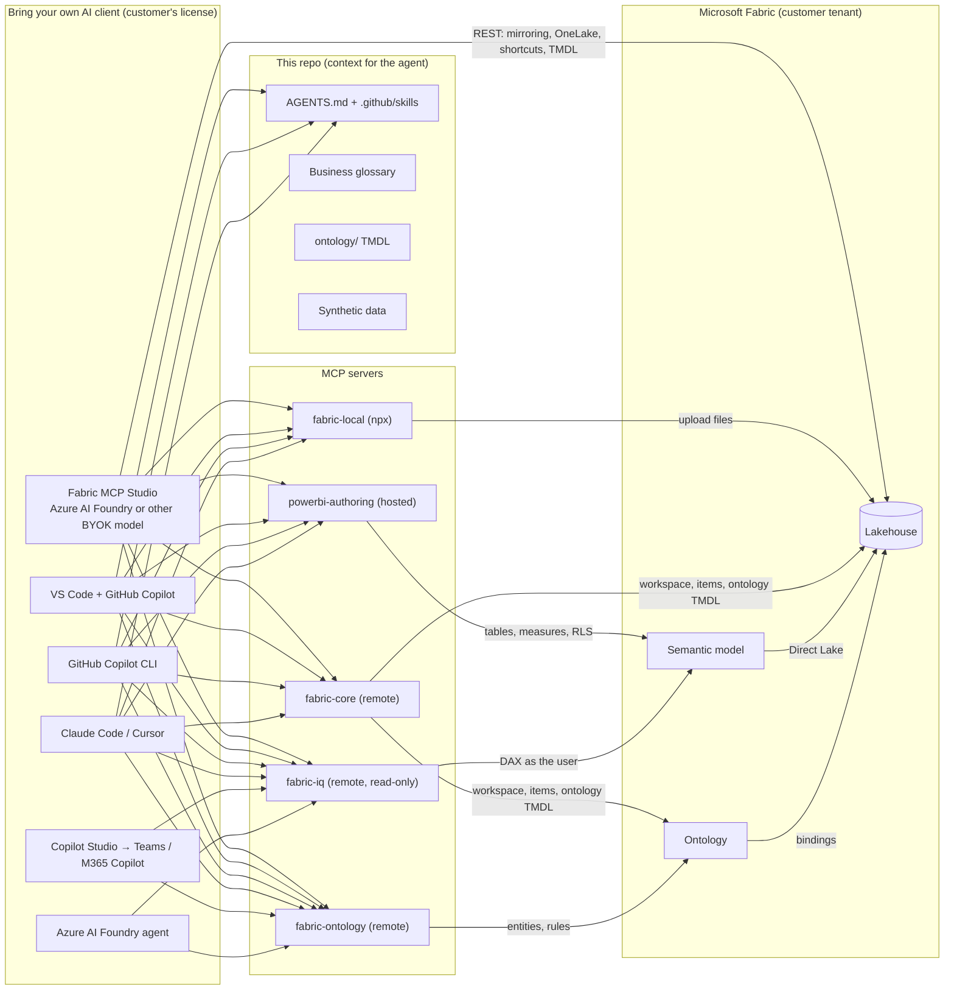

# Architecture

## Build path vs. consume path

| | Build (makers) | Consume (everyone) |
|---|---|---|
| Who | Data engineers, BI developers, analytics engineers | Business users, apps, other agents |
| Clients | Fabric MCP Studio, VS Code, Copilot CLI, Claude Code, Cursor | Copilot Studio, Microsoft 365 Copilot, Foundry, plus all builder clients |
| Servers | `fabric-core`, `fabric-local`, `powerbi-authoring` | `fabric-iq`, `fabric-ontology` |
| Output | Lakehouse tables, semantic model, ontology TMDL in Git | Governed answers that match the glossary |

## Design principles

1. **The client is swappable.** Nothing in the repo depends on one vendor's agent. `config/mcp-servers.json` is the
   single catalog; `scripts/setup.ps1` renders it for each client.
2. **Definitions live in Git.** Measures follow the glossary; ontology rules are TMDL files reviewed by pull request
   and deployed by script or by `fabric-core` `update_item_definition`.
3. **Identity is the user's.** Every server uses delegated Microsoft Entra ID. Fabric permissions, RLS and OLS apply.
4. **Deterministic fallbacks.** Every live step has a quick action in the studio and a script (`deploy-fabric.ps1`,
   `deploy-ontology.ps1`, `reset.ps1`), so results never depend on one perfect LLM run.
5. **Human in the loop.** The studio routes every write through an approval dialog and keeps an audit log; secrets
   are sent to Fabric directly and never enter the model context.

## Fabric MCP Studio internals

| Layer | Technology |
|---|---|
| UI | Vanilla ES modules served from `127.0.0.1` (per-launch token), MSX Command Center design, SSE for live events |
| Agent | GitHub Copilot SDK in `empty` mode (isolated home), customer's provider (Azure AI Foundry / Azure OpenAI, OpenAI, Anthropic or a local model in BYOK mode; GitHub Copilot in developer mode), MCP servers with Entra bearer tokens, studio tools, `onPreToolUse` approvals |
| Pipelines | Fabric REST APIs: workspaces, lakehouse load table, OneLake DFS, connections, mirroring, shortcuts, item definitions |
| Generators | Direct Lake semantic model TMDL and ontology TMDL from discovered schemas (keys, foreign keys or inferred relationships) |
| State | `studio/data/` (project, activity, chat transcripts) and `config/demo.state.json` shared with the scripts |

## Server status (October 2026)

| Server | Status |
|---|---|
| Fabric Core MCP (remote) | Available |
| Fabric MCP Server (local, `@microsoft/fabric-mcp`) | Available, open source |
| Power BI Authoring MCP | Hosted: preview · Local: GA |
| Fabric IQ MCP | GA (read-only, semantic models and reports) |
| Ontology item and Ontology MCP | Preview |

Check the linked docs in [config/mcp-servers.json](../config/mcp-servers.json) before each customer engagement.
