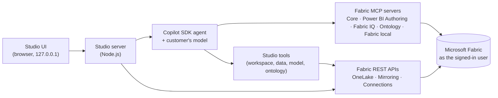

# Fabric MCP Studio

An interactive app, installed by the customer, that builds a governed data foundation in **Microsoft Fabric** by
chatting with the **AI the customer already licenses**:

- **Workspace** – create a new one on any capacity, or use an existing workspace.
- **Data** – start from sample data, mirror your databases (Azure SQL Database, Azure SQL Managed Instance,
  SQL Server on-premises via gateway, Azure Database for PostgreSQL), or reuse Fabric lakehouses, warehouses and
  mirrored databases (in place or with OneLake shortcuts).
- **Semantic model** – Direct Lake model generated from your tables and relationships, then enriched by Copilot
  (business measures from your glossary, descriptions, RLS, translations, best-practice review).
- **Ontology** – Fabric IQ entities, relationships and plain-English business rules.
- **Ask & share** – governed answers in the app chat, Microsoft 365 Copilot / Teams agent, other AI clients, Fabric data agent.

Everything runs on the customer's computer, signs in to Fabric as the customer, and **asks before every change**.

## Start

| OS | Command |
|---|---|
| Windows | Double-click `Start-Studio.cmd` (repository root or this folder) |
| macOS / Linux | `./studio/start-studio.sh` |
| Any | `cd studio && npm install && npm start` |

The first run installs dependencies (~150 MB, includes the GitHub Copilot runtime). The app opens at
`http://127.0.0.1:4870`. Options: `--port 5000`, `--no-open`, `--check` (readiness checks only).

**Requirements:** Node.js 20.19+ (LTS), a Microsoft Entra work account with access to Microsoft Fabric, and one AI
provider (below). Optional: Azure CLI (sign-in reuse and the Azure SQL sample), PowerShell (Teams agent installer).

## Choose your AI (bring your own Copilot)

| Provider | What the customer needs |
|---|---|
| **GitHub Copilot** (default) | A Copilot seat (Free, Pro, Pro+, Business, Enterprise). Sign in with GitHub CLI (`gh auth login`) or paste a token in Settings |
| **Azure AI Foundry / Azure OpenAI** | Endpoint + deployment. Microsoft Entra ID (recommended, no keys) or API key |
| **OpenAI** | API key |
| **Anthropic Claude** | API key |
| **Local model** | Any OpenAI-compatible endpoint (Ollama, LM Studio, vLLM) with tool calling |

The agent engine is the [GitHub Copilot SDK](https://github.com/github/copilot-sdk). With GitHub Copilot it uses the
customer's Copilot plan; with the other providers it runs in *bring your own key* mode, so no GitHub license is needed.
API keys stay in memory (or environment variables `AZURE_OPENAI_API_KEY`, `OPENAI_API_KEY`, `ANTHROPIC_API_KEY`).

## How it works

- **Two ways to do every step**: quick actions (deterministic, using Fabric REST APIs) or Copilot (MCP servers +
  studio tools). Both update the same project state.
- **Approvals**: every tool call that creates or changes something opens a review dialog with the exact request.
  Modes: *Ask every time* (default), *Auto-approve*, *Read-only*.
- **Secrets never reach the AI**: database credentials are entered in the Data tab and sent straight to Fabric to
  create a connection; Copilot only sees the connection ID.
- **Identity**: Microsoft Entra tokens (Azure CLI sign-in or browser) are minted locally and passed to the MCP
  servers. Fabric permissions, RLS and OLS always apply.
- **Audit**: Activity tab lists created items with links, jobs, and every approval or denial. Export as JSON.

## Data source scenarios

| Source | How it lands | Notes |
|---|---|---|
| Contoso Retail sample | Parquet → Lakehouse tables | Includes glossary, 18 business measures and 5 ontology rules |
| AdventureWorksLT sample | Provisioned on Azure SQL (serverless) → Mirroring | Needs an Azure subscription; real foreign keys |
| Azure SQL Database | Fabric Mirroring | New connection (SQL login, service principal, workspace identity) or existing |
| Azure SQL Managed Instance | Fabric Mirroring | Public endpoint or VNet data gateway |
| SQL Server 2016–2025 | Fabric Mirroring via on-premises data gateway | Create the gateway connection in Fabric, then select it |
| Azure Database for PostgreSQL | Fabric Mirroring | Flexible server prerequisites shown in the wizard |
| Fabric Lakehouse / Warehouse | In place, or OneLake shortcuts into the project lakehouse | No data copy |
| Fabric mirrored database | In place | |

Schema discovery reads tables, keys and foreign keys (from the source when reachable, or from the Fabric SQL
analytics endpoint) and infers relationships from naming conventions when no foreign keys exist.

## Files

| Path | Purpose |
|---|---|
| `server/main.mjs` | HTTP server (127.0.0.1 only, per-launch token), routes, SSE |
| `server/agent.mjs` | Copilot SDK client, providers, MCP servers, studio tools, approvals |
| `server/pipelines.mjs` | Workspace, sample, mirroring, shortcuts, semantic model, ontology, Teams agent, clean-up |
| `server/fabric.mjs` | Fabric REST client (LRO, pagination, OneLake, connections, mirroring) |
| `server/sql.mjs`, `server/pg.mjs` | Schema discovery for SQL Server family, Fabric SQL endpoints and PostgreSQL |
| `server/generators/tmdl.mjs` | Direct Lake semantic model and ontology TMDL generators |
| `server/presets.mjs` | Sample presets (names, relationships, measures, rules) |
| `server/agent-instructions.md` | System instructions for the agent |
| `web/` | UI (vanilla ES modules, MSX Command Center design, 9 themes) |
| `data/` | Local state (git-ignored): project, activity log, chat transcripts, Copilot runtime home |

## Troubleshooting

Run `npm run check` (or *Check setup* in the app). See [docs/troubleshooting.md](../docs/troubleshooting.md).
