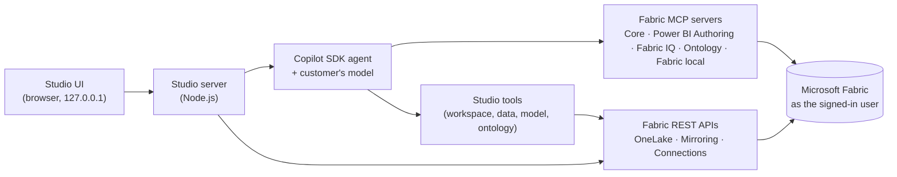

# Fabric MCP Studio

An interactive app, installed by the customer, that builds a governed data foundation in **Microsoft Fabric** by
chatting with the **AI the customer already licenses**:

- **Workspace** – create a new one on any capacity, or use an existing workspace.
- **Naming standard** – every item the studio creates is named `[Domain]_[Object]_[Purpose]_[Environment]`
  (for example `Sales_SM_Revenue_PROD`). The Overview and Workspace pages ask what the environment is for (demo, proof
  of concept, development, test, user acceptance, production, training or sandbox) and the business domain.
- **Data** – start from sample data (Contoso Retail, or AdventureWorksDW2022 created as a Fabric SQL database), mirror
  your databases (Azure SQL Database, Azure SQL Managed Instance, SQL Server on-premises via gateway, Azure Database
  for PostgreSQL), or reuse Fabric lakehouses, warehouses, mirrored databases and SQL databases (in place or with
  OneLake shortcuts). When the data source is a **lakehouse**, an option creates a **data prep notebook** (Python)
  that cleans, renames, models, measures and charts the data.
- **Semantic model** – Direct Lake model generated from your tables and relationships, then enriched by Copilot
  (business measures from your glossary, descriptions, RLS, translations, best-practice review).
- **Ontology** – Fabric IQ entities, relationships and plain-English business rules.
- **Reports & apps** – polished Power BI reports built on your semantic model from page templates and themes.
- **Real-time** – live events shaped like your data streamed through an Eventstream into an Eventhouse, with an
  auto-refreshing Real-Time Dashboard, live time-series properties in the ontology and Activator alerts on rule breaks,
  plus the **medallion architecture** (Bronze, Silver, Gold) applied to the stream and shown as a Fabric task flow.
- **Planning** – a budget and rolling forecast from your actuals, a Plan table with variance measures in the model, a
  Plan vs actual report, and the Fabric plan for planning sheets.
- **Ask & share** – governed answers in the app chat, Microsoft 365 Copilot / Teams agent, other AI clients, and a
  **Fabric data agent** on the semantic model (Copilot suggests the instructions, **Apply suggestions** creates and
  publishes it; the studio writes the item definition with every table, column and measure).
  Suggested questions are built from what you have – the semantic model's measures, dimensions and years, your
  reports, ontology rules, plan, live data and data source – and shown on the Overview, Ask & share and each page.

Everything runs on the customer's computer, signs in to Fabric as the customer, and **asks before every change**.

> **Sample app, provided as is** – not an official Microsoft product or supported service. Whoever runs it sees the
> [disclaimer](../README.md#disclaimer) once (and from the footer or **Settings › About**). The version is
> **1.<improvements>.<fixes>**, calculated from [`releases.json`](releases.json); select the version in the header for
> what's new.

## Start

| OS | Command |
|---|---|
| Windows | Run `.\scripts\create-shortcut.ps1` once for a **Fabric MCP Studio** desktop icon (`-StartMenu` adds it to the Start menu), or double-click `Start-Studio.cmd` (repository root or this folder) |
| macOS / Linux | `./studio/start-studio.sh` |
| Any | `cd studio && npm install && npm start` |

The first run installs dependencies (~150 MB, includes the GitHub Copilot runtime). The app opens at
`http://127.0.0.1:4870`. Launching it again while it is running just reopens the running copy in your browser.
Options: `--port 5000`, `--no-open`, `--check` (readiness checks only), `--new-instance` (start another copy).

The desktop icon starts the studio in the background, with no console window (`Start-Studio-Silent.wsf`, Windows
Script Host). Stop it with **Shut down** in the app header; server output goes to `studio/data/studio.log`.
`Start-Studio.cmd` runs it in a console window instead (`create-shortcut.ps1 -ShowConsole` makes the icon do the same,
and it is used automatically when Windows Script Host is turned off).

**Requirements:** Node.js 20.19+ (LTS), a Microsoft Entra work account with access to Microsoft Fabric, and one AI
provider (below). Optional: Azure CLI (sign-in reuse), PowerShell (Teams agent installer). The AdventureWorksDW2022 sample
downloads Microsoft's install kit (17 MB) from github.com once.

## Choose your AI (bring your own model)

| Provider | What the customer needs |
|---|---|
| **Azure AI Foundry / Azure OpenAI** (default) | Endpoint + deployment. Microsoft Entra ID (recommended, no keys) or API key |
| **OpenAI** | API key |
| **Anthropic Claude** | API key |
| **Local model** | Any OpenAI-compatible endpoint (Ollama, LM Studio, vLLM) with tool calling |
| **GitHub Copilot** (developer mode only) | A Copilot seat. Sign in with GitHub CLI (`gh auth login`) or paste a token in Settings |

The agent engine is the [GitHub Copilot SDK](https://github.com/github/copilot-sdk); with the providers above it runs
in *bring your own key* mode, so business users need no GitHub account or license. API keys stay in memory (or
environment variables `AZURE_OPENAI_API_KEY`, `OPENAI_API_KEY`, `ANTHROPIC_API_KEY`).

**Developer mode** is for the people who build and test the studio: it adds **GitHub Copilot** as a provider (and the
GitHub Copilot clients on Ask & share). Turn it on for your own computer only, with the `STUDIO_DEVELOPER=1`
environment variable or an empty file named `developer` in the studio's data folder (`studio/data/developer`), then
restart the studio. Settings › About shows when it's on.

## How it works

- **Solution map**: the app opens on a lineage map of everything it builds, from the data source through OneLake,
  the semantic model and the ontology to reports, the plan, Copilot answers, the Microsoft 365 agent and the
  real-time items (live events → Eventstream → Eventhouse → Real-Time Dashboard, Activator alerts, live ontology
  properties). Parts stay greyed out until they are configured, then light up with their names and details; the
  edges show what is built from what, the suggested next part pulses, running jobs and live streams animate, and
  parts that can't run show a badge. On the overview, select a part to see its details, what it is built from and
  what it feeds, with *Open*, *Let Copilot do it* and *Open in Fabric*; elsewhere the map stays on top in a compact
  form (or hidden with *Hide map*) and selecting a part opens its page.
- **Two ways to do every step**: quick actions (deterministic, using Fabric REST APIs) or Copilot (MCP servers +
  studio tools). Both update the same project state.
- **Copilot inside every step**: Copilot opens right in the page you are working in (for example below the tables and
  relationships in *Semantic model*), never in a separate window. The **Copilot** page shows the same conversation full size.
- **Approvals**: every tool call that creates or changes something opens a review dialog with the exact request.
  Modes: *Ask every time* (default), *Auto-approve*, *Read-only*. Every recommendation that waits for your go-ahead
  gets an **Apply** button under Copilot's answer – semantic models, reports and data agents (**Apply suggestions**), and
  everything else (ontology rules, a plan, medallion layers, live data…) through `studio_suggest_apply`, or a
  *✓ Apply* card when an answer ends by asking you to confirm. No need to type "yes" or "proceed".
- **Secrets never reach the AI**: database credentials are entered in the Data page and sent straight to Fabric to
  create a connection; Copilot only sees the connection ID.
- **Identity**: Microsoft Entra tokens (Azure CLI sign-in or browser) are minted locally and passed to the MCP
  servers. Fabric permissions, RLS and OLS always apply.
- **Audit**: the Activity page lists created items with links, jobs, and every approval or denial. Export as JSON.
- **Up-front checks**: the studio reads the workspace's capacity (running or paused, SKU, trial), your workspace role,
  the tenant settings each step needs (when you are a Fabric administrator) and what your data source supports. Parts
  that can't run get a red badge on the map and their page a banner with the reason and the fix, and their actions
  are disabled; parts that run with limits say so. Jobs and Copilot tools stop before changing anything when their
  step can't run. *Check setup* and `npm run check` show the same list.

## Naming standard

Every item the studio creates follows **`[Domain]_[Object]_[Purpose]_[Environment]`**, so anyone can tell what an item
is, what it's for and where it runs. The **Overview** and **Workspace** pages ask *What is this environment for?* and the
business domain, with a live preview of the names; Copilot asks too (`studio_set_naming`) before it creates anything.

| Part | What it is | Examples |
|---|---|---|
| Domain | The business area, in PascalCase | `Sales`, `Finance`, `Retail`, `SupplyChain` |
| Object | A short code for the item type | `WS` workspace · `LH` lakehouse · `WH` warehouse · `SQLDB` SQL database · `MDB` mirrored database · `CONN` connection · `NB` notebook · `PL` pipeline · `SM` semantic model · `RPT` report · `APP` org app · `ONT` ontology · `DA` data agent · `PLAN` plan · `EH` eventhouse · `KQLDB` KQL database · `ES` eventstream · `KQS` KQL queryset · `RTD` Real-Time Dashboard · `ACT` Activator · `TF` task flow |
| Purpose | What the item does, in PascalCase | `Raw`, `Curated`, `Sales`, `Executive`, `BusinessRules`, `PlanVsActual`, `Budget`, `Live`, `BronzeToSilver` |
| Environment | What the environment is for | `DEMO` demo · `POC` proof of concept · `DEV` development · `TEST` testing · `UAT` user acceptance · `PROD` production · `TRN` training · `SBX` sandbox |

For example, the Contoso Retail sample in a demo environment gives `Retail_WS_Analytics_DEMO`, `Retail_LH_Raw_DEMO`,
`Retail_SM_Sales_DEMO`, `Retail_RPT_Executive_DEMO` and `Retail_DA_Sales_DEMO`. Names typed in the app or suggested by
Copilot become the purpose (`Sales report` → `Retail_RPT_Sales_DEMO`); a full standard name is kept as it is. Until you
choose, the samples suggest their domain with `DEMO`, and a workspace whose name already follows the standard suggests
its own. **Items that already exist keep their names**, so nothing is renamed or duplicated when you change the
standard; a second item with the same purpose gets a number (`Curated2`). Names fit Fabric's strictest rules (letters,
numbers and underscores, 89 characters).

## Medallion task flow

The **Workspace** page applies Fabric's predesigned **Medallion** task flow to what the studio already built, so the
workspace shows how the data flows, with each item assigned to its task: **Data ingest** (how the data arrives) ›
**Bronze data** (the lakehouse, SQL database or mirrored database as the data lands) › **Initial process** (the data
prep notebook) › **Silver data** (the curated lakehouse) › **Further transform** (optional) › **Gold data** (the semantic
model with governed measures, and the plan values) › **Visualize** (reports) and **Distribute** (the org app), plus
**Business context and AI** (ontology, data agent) and **Plan and forecast** (the Fabric plan). The card shows the
mapping before anything changes; *Apply the Medallion task flow* creates it (named `<Domain>_TF_Medallion_<Env>`), and
it's updated automatically as the studio adds items. Only items in the project workspace can be assigned. Copilot:
`studio_medallion_task_flow_status` and `studio_apply_medallion_task_flow`. (Live events have their own medallion on
the Real-time page.)

## Data source scenarios

| Source | How it lands | Notes |
|---|---|---|
| Contoso Retail sample | Parquet → Lakehouse tables | Includes glossary, 18 business measures and 5 ontology rules |
| AdventureWorksDW2022 sample | Fabric SQL database in the project workspace → OneLake (automatic replication) | Microsoft's official install kit: 28 tables, 1.05M rows, real primary and foreign keys. Includes a glossary, 24 measures and 5 ontology rules. Needs the Admin or Member workspace role |
| Azure SQL Database | Fabric Mirroring | New connection (SQL login, service principal, workspace identity) or existing |
| Azure SQL Managed Instance | Fabric Mirroring | Public endpoint or VNet data gateway |
| SQL Server 2016–2025 | Fabric Mirroring via on-premises data gateway | Create the gateway connection in Fabric, then select it |
| Azure Database for PostgreSQL | Fabric Mirroring | Flexible server prerequisites shown in the wizard |
| Fabric Lakehouse / Warehouse | In place, or OneLake shortcuts into the project lakehouse | No data copy |
| Fabric mirrored database | In place | |
| Fabric SQL database | In place (its SQL analytics endpoint) | |

Schema discovery reads tables, keys and foreign keys (from the source when reachable, or from the Fabric SQL
analytics endpoint) and infers relationships from naming conventions when no foreign keys exist.

### Data prep notebook (lakehouse sources)

When the data source is a lakehouse (the Contoso Retail sample, a lakehouse used in place, or OneLake shortcuts), tick
**Also create a data prep notebook** – or use the **Data prep notebook** card on the Data page, or ask Copilot
(`studio_create_data_prep_notebook`). The studio creates a Fabric **Python notebook** (pandas, no Spark) in the project
workspace and runs it. Nothing about the data is fixed in the notebook: only which lakehouse to read and which to write.
Every run works the rest out from the data, so it works for any lakehouse and can be run again as tables change:

| Step | What it does |
|---|---|
| Discover | Lists every Delta table (lakehouses with or without schemas, shortcuts included) and profiles it |
| Better names | Business names for tables (`dim_cust` → `Customer`) and columns (`cust_nm` → `CustomerName`, `DiscountPct` → `DiscountPercent`) |
| Data fixes | Trims text, blank → missing, consistent category spelling, text → dates and numbers, placeholder dates, empty columns, duplicate rows and keys; negatives, outliers, future dates and unmatched keys are kept and counted. Every fix is logged in a `DataQuality` table |
| Keys and relationships | Each table's key, and the columns that point to other tables (the name must match **and** at least 80% of the values must be found); facts and dimensions follow from them |
| New measures | Net amount, total cost, gross margin and margin %, date parts and value bands; a `KPIs` table with the matching DAX. Amounts are summed; temperatures, prices, rates and scores are averaged |
| Curated tables | Delta tables in a new curated lakehouse, `<Domain>_LH_Curated_<Env>` (or back to the source with the `Curated_` prefix) |
| Charts | KPI tiles, tables overview, model diagram, trend, top items, pie, breakdowns, Pareto, weekday × month heatmap, distribution, box plot, treemap, correlation, missing values and data fixes – each with a one-line insight, shown on the Data page |

**Use the curated lakehouse as the data source** to build the semantic model, ontology and reports on the curated tables.
Clean up deletes the notebook and the curated lakehouse.

## Reports

**Reports & apps** builds Power BI reports (PBIR format) on the project's semantic model and deploys them with the
Fabric REST API – no Power BI Desktop needed.

1. **What we found in your model** – read-only DAX (`INFO.VIEW` functions and a short data profile) picks the headline
   KPIs, channel measures, the time grain and full years, a share dimension, a breakdown, the top-10 entity and a drill
   path. It works for any model you can query, including models the studio didn't create.
2. **Pages** – executive summary, performance drivers (drill-down matrix, year by segment, top contributors),
   scorecard (segment × year, ratio trend, ranked table) and **business rules** – the ontology dashboard: every
   ontology rule in plain English next to its live count, rule breaks by year and by segment, and where they happen.
   Rule measures the semantic model doesn't have yet are added to the report as report-level measures, so no model
   change is needed. Layouts follow Microsoft's Power BI report design guidance:
   1280×720, 24 px margins, header band, KPI row, hero visual, sorted bars, top-N lists.
3. **Themes** – Fabric Studio, Executive Navy, Teal Modern, Slate Minimal, Accessible (color-blind safe) and Midnight.
   All formatting lives in a custom report theme, so you can switch themes later in Power BI.
4. **Build** – creates or updates the Report item, then renders a PDF preview with Power BI export (if your tenant turns
   export off, open the report in Power BI instead). Partial years are filtered out so comparisons use full years.

Copilot can recommend pages and a theme for your audience (`studio_describe_report_options`) and suggest the report
(`studio_propose_report`); **Apply suggestions** reviews and builds it in one click. The page also shows
**Recommended for your data** – ready-made report recommendations with the reasons from your model.

**Org app** – *Create app* bundles the studio's reports into a Fabric org app: an overview page, a *Reports* section
and a *Business rules* section, in the report theme's colors. People get the app without access to the workspace: open
it in Fabric, add an audience and publish it. Rebuilding updates the app in place (`studio_create_org_app` for Copilot).

## Real-time

**Real-time** streams live events into Real-Time Intelligence, builds a dashboard over them, adds them to the
ontology and alerts people when a business rule is broken.

1. **Set up live data** – creates (or reuses) an Eventhouse and a table shaped like the project's data, and an
   Eventstream with a **custom endpoint** source and the Eventhouse as destination. For the samples the table holds
   order lines (`SalesEvents`: products, customers or resellers, territories, quantity, price, discount, cost, margin,
   rule broken); for any other model it holds `BusinessEvents` with the model's main measure and top dimensions.
2. **Live events** – the simulator sends events to the custom endpoint (Event Hubs protocol over HTTPS). Events use
   real keys, names and prices read from your data, and a share of them break the business rules (for AdventureWorks:
   *discount needs approval* at 30% or more, *sold below cost*). Choose events per minute, the share of rule breaks and
   when to stop (it always stops on its own). When the table has no recent data, the last hour is filled first so the
   charts aren't empty. The endpoint key stays in memory in the studio – it is never saved or shown to Copilot.
3. **Real-Time Dashboard** – a *Live overview* page (orders, amount, margin and rule-break KPIs, amount per minute by
   channel, mix, regions, top items, latest events) and a *Business rules* page (a count per rule, share of events
   breaking a rule, loss below cost, breaks per minute, who breaks the rules, latest breaks). It refreshes every 30
   seconds; every tile query is checked against the Eventhouse before the dashboard is deployed.
4. **Live ontology** – binds the live table to the ontology. Every entity type whose key the events carry (for
   AdventureWorks: Product, Customer, Reseller, Sales territory) gets time-series properties – `LiveSalesAmount`,
   `LiveQuantity`, `LiveDiscountPct`, `LiveMargin`, `LiveRuleBreak` and more, ordered by event time and read live from
   the Eventhouse (no copy) – plus a link to the Real-Time Dashboard. The ontology's tables are also tagged with their
   source item so Fabric can preview instances. Re-running replaces the earlier bindings; *Remove live properties*
   takes them off again, and re-deploying the ontology from the Ontology page keeps them.
5. **Alerts on rule breaks** – a Fabric **Activator** queries the live table every minute and, for each business-rule
   break, sends a Teams message or an email with the order, buyer, region, amount, discount and margin. One Activator
   rule per business rule; pick the rules, the recipients and an optional minimum amount. The card estimates how many
   messages to expect at the current event rate.
6. **Stream your own events** – copy the custom endpoint's connection string and send JSON events with the same columns
   from any app; they land in the same table, dashboard, ontology properties and alerts.

Copilot tools: `studio_realtime_status`, `studio_query_live_events` (read-only KQL), `studio_setup_live_data`,
`studio_start_live_events`, `studio_stop_live_events`, `studio_create_realtime_dashboard`,
`studio_connect_live_ontology` and `studio_create_live_alerts`.

### Medallion architecture for the live events

**Real-time › Medallion architecture** applies Microsoft's
[Real-Time Intelligence medallion pattern](https://learn.microsoft.com/fabric/real-time-intelligence/architecture-medallion)
to the existing live events, and shows it in Fabric as a workspace **task flow** (the *Event medallion* flow).
Everything is processed as it arrives – no schedules – and the template adapts to the table's columns.

| Layer | In the Eventhouse (one KQL database, folders *Bronze*, *Silver*, *Gold*) | Fabric item (task flow task) |
|---|---|---|
| Bronze | The existing events table, kept as it arrives for replay (retention you choose) | Eventhouse (*Bronze layer*) |
| Bronze → Silver | Update policies: data-quality checks (time, keys, quantity, price, discount, amount), enrichment (`EventHash`, `EventDate`, `IsRuleBreak`, `MarginPct`); failures go to `<table>_Quarantine` with the reason | KQL queryset `<name>_Bronze_to_Silver` (*Bronze to Silver*) |
| Silver | `<table>_Silver` and the deduplicated view `<table>_Silver_Dedup` (`take_any(*)` by `EventHash`); Silver is published to OneLake as Delta | Lakehouse `<name>_Silver` with a shortcut to the Silver Delta table (*Silver layer*) |
| Silver → Gold | Materialized views over the deduplicated Silver data, late events included | KQL queryset `<name>_Silver_to_Gold` (*Silver to Gold*) |
| Gold | `<table>_Gold_PerMinute`, `<table>_Gold_Daily`, `<table>_Gold_Latest` (latest event per customer) | Semantic model `<model> Live Gold` – DirectQuery on the Gold views, single sign-on, measures for amount, events, rule breaks, margin (*Gold layer*) |

The Real-Time Dashboard (*Realtime visualize*), the Activator (*Realtime activation*) and the live ontology
(*Business context*) move to the clean data: the dashboard reads Silver and the Gold views and gains a *Medallion layers*
page (events per layer, data quality, duplicates removed, Silver freshness, quarantine reasons); alerts and live
properties read the deduplicated Silver view, so a duplicate event never sends a second message.

- The simulator's **Data issues** setting (1% by default once the layers exist) sends duplicates, missing keys, zero
  quantities, negative amounts and future times, so the quarantine and deduplication have something to show.
- **Update layers** is safe to run again (it keeps what already matches and rebuilds what changed). **Remove** deletes
  the task flow and the layer items, points the dashboard, alerts and ontology back at Bronze, then drops Silver and
  Gold; the raw events stay. **Clean up resources** removes the task flow too.
- Task flows have no public API; the studio uses the same workspace endpoints as the Fabric portal and only changes the
  task flow it created. If that fails (for example a tenant policy), the layers still work and the card shows why.

Copilot tools: `studio_medallion_status`, `studio_apply_medallion` and `studio_remove_medallion`.

## Planning

**Planning** starts a budget and a rolling forecast from your actuals and connects them to Fabric planning (Fabric IQ).

1. **Design the plan** – the studio reads the semantic model (main measure, date table, regions and categories) and
   recommends a plan year, a growth target (last year's growth, kept between -10% and 25%) and a forecast cut-off.
   Change the measure, the year, up to two dimensions, the growth, or a growth per region or category; the preview
   shows the budget, forecast and actuals by month and by member before anything is written.
2. **Build the plan** – budget = base-year actuals × (1 + growth) month by month, so seasonality is kept; forecast =
   actuals up to the cut-off, then the budget × each member's run rate (actual ÷ budget so far, kept between 80% and
   125%). The rows go to `planning.PlanValues` next to your data – in a Fabric SQL database or warehouse; for a
   **lakehouse** (whose SQL endpoint is read-only) in a planning warehouse in the project workspace, which the lakehouse
   reads through a OneLake shortcut `Tables/PlanValues` – and the studio waits until the SQL endpoint shows them, and a **Plan** table is added to the semantic model with
   *Actual, Budget, Forecast, Budget to Date, Variance to Budget, Variance to Budget %, Budget Attainment %, Forecast vs
   Budget* and *Forecast vs Budget %*. The totals are checked through the model. Rebuilding the semantic model keeps the
   Plan table; *Remove…* takes it out again.
3. **Plan vs actual report** – a Power BI page with actual, budget, variance and forecast KPIs, the monthly trend of
   all three, and the variance by region and category (also a page template in Reports & apps).
4. **Plan in Fabric** – creates the Fabric plan item for planning sheets. By default it has no connection: when the plan
   opens, Fabric asks the planner to choose or create a semantic model connection and sign in with their own account
   (Contributor or higher in the workspace). You can also bind it to a shared Power BI semantic model connection – it
   then reads the model with the sign-in saved in that connection, for everyone. Fabric keeps a plan's model and
   connection once it exists, so *Change the connection* – and *Check the plan* when the plan points to a model that was
   recreated – deletes and recreates the plan, only while it has no sheets. Planners add rows like
   *Region › Category*, columns *Year › Month* and values *Budget, Forecast, Actual*, adjust the numbers, comment,
   approve and write back to a SQL database.
   **Who can plan** lists the workspace's people and roles and gives someone access in one step (Contributor for planners, Member for the account saved in a shared connection): a plan
   reads the model as the account saved in its connection, so when a plan says *Can't access the semantic model*, that
   account (often your own, not the one the studio uses) must be Member or Admin, and not a guest – or sign the connection in again (Manage
   connections and gateways › Edit credentials). The connection list also says when a connection's sign-in has expired.

Planning needs a date table with year and month number columns related to your facts. It works on lakehouses,
warehouses and Fabric SQL databases. A **mirrored database** is a read-only copy (only Fabric mirroring writes to it)
and the Direct Lake model reads every table from it, so there is nowhere for the plan values: the Planning page says
so and how to fix it – bring the mirrored tables into a lakehouse with OneLake shortcuts (Data page) and rebuild the
model on it.

Copilot tools: `studio_planning_status`, `studio_preview_plan`, `studio_create_plan` and `studio_create_plan_item`.

## Files

| Path | Purpose |
|---|---|
| `server/main.mjs` | HTTP server (127.0.0.1 only, per-launch token), routes, SSE |
| `server/agent.mjs` | Copilot SDK client, providers, MCP servers, studio tools, approvals |
| `server/pipelines.mjs` | Workspace, sample, mirroring, shortcuts, semantic model, ontology, Teams agent, clean-up |
| `server/fabric.mjs` | Fabric REST client (LRO, pagination, OneLake, connections, mirroring) |
| `server/sql.mjs`, `server/pg.mjs` | Schema discovery for SQL Server family, Fabric SQL endpoints and PostgreSQL |
| `server/generators/tmdl.mjs` | Direct Lake semantic model and ontology TMDL generators |
| `server/generators/notebook.mjs` | Data prep notebook (Fabric Python notebook) for any lakehouse: discovery, names, fixes, relationships, measures, curated tables, charts |
| `server/dataprep.mjs` | Data prep notebook job: curated lakehouse, notebook item, run and results (summary and charts) |
| `server/prompts.mjs` | Suggested questions grouped by what the project has, built from the semantic model profile, reports, rules, plan, live data and data source |
| `server/dataagent.mjs` | Fabric data agent on the semantic model: suggestions, item definition (data source with tables, columns, measures; instructions), create/update and publish |
| `releases.json` | Every improvement and fix; the version (1.<improvements>.<fixes>) and What's new are calculated from it |
| `web/js/about.js` | Disclaimer (shown once per installation) and What's new |
| `server/generators/pbir.mjs` | Power BI report (PBIR) generator: pages, visuals, filters, theme registration |
| `server/reports/` | Model profile (`profile.mjs`), page templates, report themes and the report build/preview pipeline |
| `server/powerbi.mjs` | Power BI REST: DAX queries, model metadata (`INFO.VIEW`), report export for previews |
| `server/realtime/` | Live data: Eventhouse/Eventstream setup, live ontology, alerts and medallion job (`index.mjs`), medallion layers – KQL generated from the column roles, apply, remove and health (`medallion.mjs`), the Fabric items per layer – querysets and the Gold DirectQuery model (`medallion-items.mjs`), event scenarios shaped like the data (`scenarios.mjs`), simulator sending to the custom endpoint (`simulator.mjs`), Real-Time Dashboard generator (`dashboard.mjs`), Activator alert definition (`alerts.mjs`), KQL client (`kusto.mjs`) |
| `server/taskflow.mjs` | Workspace task flows (the portal's metadata endpoints): list, create, update, delete, item assignments |
| `server/generators/ontology-live.mjs` | Adds or removes Eventhouse time-series bindings and dashboard links on an existing TMDL ontology |
| `server/planning/` | Budgets and forecasts: plan design and calculation (`design.mjs`), plan values in the SQL database, warehouse or (for a lakehouse) a planning warehouse with a shortcut (`store.mjs`), the Plan table patch for the semantic model (`model.mjs`), jobs, plan item and summary (`index.mjs`) |
| `server/readiness.mjs` | Up-front checks: capacity, workspace role, tenant settings and data-source limits per step, and the guard that stops jobs of steps that can't run |
| `server/medallion-flow.mjs` | Fabric's Medallion task flow over the project's items (layers, mapping, create/update, automatic sync after jobs); `web/js/medallionflow.js` is the Workspace page card |
| `server/naming.mjs` | Naming standard `[Domain]_[Object]_[Purpose]_[Environment]`: environments, object codes, the name of every item the studio creates (`web/js/naming.js` shows the same names and asks what the environment is for) |
| `server/presets.mjs` | Sample presets (names, relationships, measures, rules) |
| `server/samples/adventureworks-dw.mjs` | AdventureWorksDW2022 loader for Fabric SQL database (install kit → tables, keys, bulk load, verification) |
| `server/agent-instructions.md` | System instructions for the agent |
| `web/` | UI (vanilla ES modules, MSX Command Center design, 9 themes); `web/js/lineage.js` draws the solution map |
| `assets/` | App icon (`fabric-mcp-studio.ico` / `.png`) used by the desktop shortcut |
| `Start-Studio-Silent.wsf` | Windows launcher used by the desktop shortcut: starts the studio without a console window, reuses a running copy, reports start-up errors |
| `data/` | Local state (git-ignored): project, activity log, chat transcripts, Copilot runtime home, `studio.log` |

## Troubleshooting

Run `npm run check` (or *Check setup* in the app). See [docs/troubleshooting.md](../docs/troubleshooting.md).
